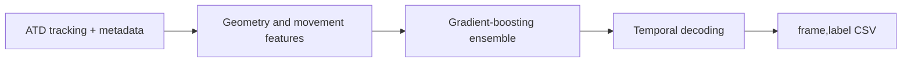

# DaRiAn — Football Possession from Tracking Data

[](https://www.python.org/downloads/)
[](https://scikit-learn.org/)
[](#how-it-works)
[](#status)
[](LICENSE)

DaRiAn is our submission for **More Than a Hack 2027**. It estimates ball possession throughout a football match using automatic player and ball tracking, producing one label for every video frame.

The challenge is continuity: a pass, a deflection, or a briefly missing ball should not automatically become a new possession. We combine learned frame-level evidence with a temporal model that resolves the sequence across each half.

| Label | Meaning |
| --- | --- |
| `H` | Home-team possession |
| `A` | Away-team possession |
| `D` | Dead ball / play stopped |
| `X` | Abstention; emitted outside the published playing halves |

## How It Works



**Features.** Positions are converted to metres. We measure ball-to-team distances, visibility, ball motion, pitch-edge proximity, collective player movement, and recent and future control evidence. Each half is processed separately.

**Model.** Two histogram gradient-boosting classifiers learn from separate external matches. Training includes home/away mirroring, missing-ball intervals, position noise, and brief false tracks. Predictions are averaged across both models and mirrored team assignments.

**Sequence.** An offline dynamic program balances the model's evidence against unnecessary changes of state:

$$
\hat{y}=\arg\min_y\left[
-\frac{1}{f}\sum_{t=1}^{T}\log\!\left(\max(p_t(y_t),10^{-6})\right)
+\lambda\sum_{t=2}^{T}\mathbf{1}[y_t\ne y_{t-1}]
\right].
$$

Here, $p_t$ is the ensemble's evidence for home, away, or dead ball; $f=25$ frames per second; and $\lambda=1$ penalises state changes. Transitions are searched on a five-frame grid, while the output retains every frame. These settings were selected on external development matches. Future observations help resolve earlier gaps, so this method processes a completed recording.

## Training Data

We use **[Metrica Sports Sample Data](https://github.com/metrica-sports/sample-data)**: public, anonymised tracking and event annotations provided by Metrica Sports.

| Dataset | Role |
| --- | --- |
| [Sample Game 1](https://github.com/metrica-sports/sample-data/tree/e706dd506b360d69d9d123d5b8026e7294b13996/data/Sample_Game_1) | Train the first model; validate the second |
| [Sample Game 2](https://github.com/metrica-sports/sample-data/tree/e706dd506b360d69d9d123d5b8026e7294b13996/data/Sample_Game_2) | Train the second model; validate the first |
| [Sample Game 3](https://github.com/metrica-sports/sample-data/tree/e706dd506b360d69d9d123d5b8026e7294b13996/data/Sample_Game_3) | Reserved external evaluation; excluded from fitting and decoder selection |

Possession references are derived mechanically from the published events. They are approximate proxy labels, rather than manually corrected frame-level possession ground truth. Downloads are pinned to revision [`e706dd5`](https://github.com/metrica-sports/sample-data/tree/e706dd506b360d69d9d123d5b8026e7294b13996), with SHA-256 manifests recorded and checked by the training scripts.

The competition match supplies tracking for inference only. Its possession labels are not used for training or parameter selection. Restricted match assets are not included in this repository.

## Run the Submission

Use **Python 3.11** and the organisers' match bundle:

```bash
python3.11 -m venv .venv
source .venv/bin/activate
python -m pip install -r requirements.txt
python starter/run_darian.py --data-dir "/path/to/match-bundle" --output DaRiAn.csv
```

The bundle root must contain `tactical/` with the supplied ATD XML and TXT. Inference reads tracking and metadata; video decoding is not required.

The runner checks source and model hashes, generates all **199,319 rows**, runs the official format validator, and verifies the final CSV's SHA-256 against the release manifest. Local diagnostics include frame probabilities and transition timestamps.

## Reproduce Training and Checks

```bash
# Download the pinned external samples, train, and evaluate
python starter/train_possession_v4.py --download

# Check features, perturbations, and temporal decoding
python -m unittest starter.test_features starter.test_possession
```

Training writes to `data/derived/possession_v4/`. To run the retrained model:

```bash
python starter/possession_v4.py --model data/derived/possession_v4/model.joblib
```

## Status

**Hackathon deliverable.** This repository contains the selected v4 model, standalone training code, and a verified reproduction command. The release passes 31 synthetic tests and reproduces the final CSV byte for byte.

Evaluation is limited by three external matches and approximate event references. Short possessions, ambiguous restarts, and long tracking gaps remain difficult. The private hackathon score is unknown.

## Documentation and Submission

- [Technical document](DaRiAn.md): model details, external results, data provenance, and limitations.
- [Submission requirements](SUBMISSION.md): submit `DaRiAn.csv`, the public repository URL, and `DaRiAn.md`.
- [Evaluation guide](EVALUATION.md): scoring definitions and official metrics.
- [Original starter documentation](SOURCE_README.md): organisers' reference material; use the commands above for this release.

## License and Attribution

Code is provided under the [MIT License](LICENSE). Competition assets have separate usage terms; see [DATA.md](DATA.md) and [RULES.md](RULES.md). Public training and evaluation data are credited to [Metrica Sports](https://github.com/metrica-sports/sample-data).
